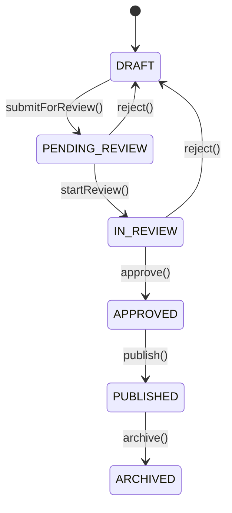

# Taller 10 — Persistencia de datos con JPA y arquitectura limpia

Banco de Preguntas Saber Pro · Laboratorio de Ingeniería de Software II · Universidad del Cauca · 2026.2

## Tecnologías

- Java 17+
- Spring Boot 3, Spring Data JPA
- H2 (base de datos en memoria)
- Maven, JUnit 5

## Estructura de paquetes

```
co.edu.unicauca.questionbank
├── api/                      # Controladores REST
├── application/              # Casos de uso (servicios)
├── domain/
│   ├── model/                # Clases de dominio puras (sin JPA)
│   └── repository/           # Contratos de repositorio
└── infrastructure/
    └── jpa/
        ├── record/           # Modelos relacionales JPA
        ├── repository/       # Implementaciones con Spring Data JPA
        └── mapper/           # Conversión dominio <-> record
```

## Análisis del dominio

**Actores:** Administrador (usuarios, roles y parámetros), Autor (crea y modifica preguntas), Revisor (evalúa calidad y pertinencia), Docente (organiza cuestionarios) y Estudiante (responde y consulta resultados).

**Ciclo de vida de una pregunta:**



Solo las preguntas **publicadas** pueden usarse en cuestionarios.

**Alcance elegido:** `User`, `Role`, `Topic`, `Competency`, `Question` (abstracta) con `MultipleChoiceQuestion` y `TrueFalseQuestion`, `AnswerOption`, `QuestionMetadata` y `Quiz`. Con estas clases se cubren los cuatro tipos de relación y la herencia que pide el taller. `Review`, `Attempt` y `Result` quedan fuera del alcance de este taller.

### Diagrama de clases del dominio


## Ejecución

```bash
mvn spring-boot:run
```

Consola H2: <http://localhost:8080/h2-console> (JDBC URL `jdbc:h2:mem:questionbank`, usuario `sa`, sin contraseña).

## Pruebas

```bash
mvn test
```
