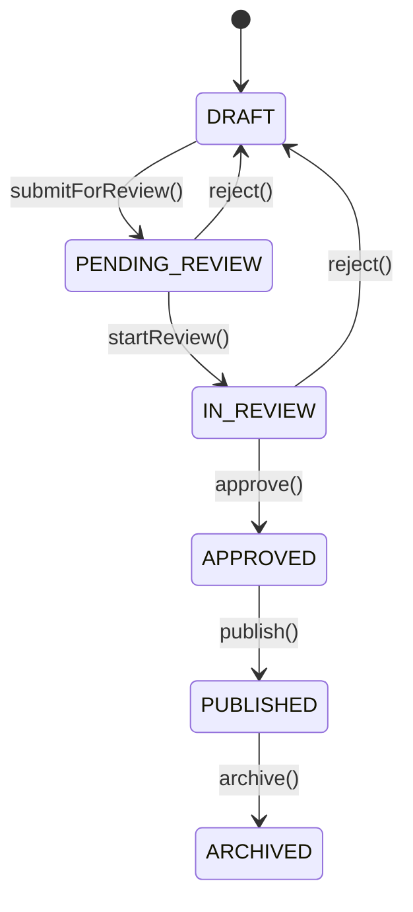
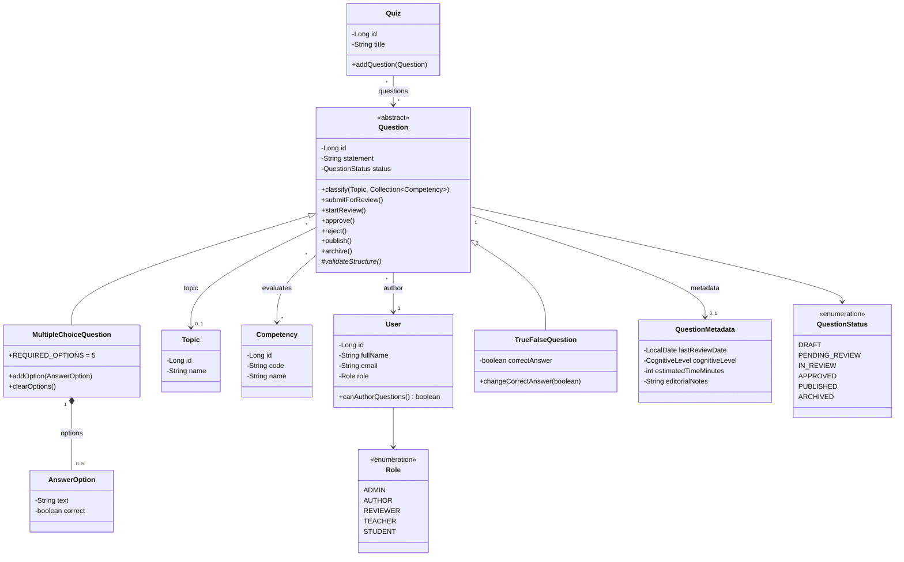
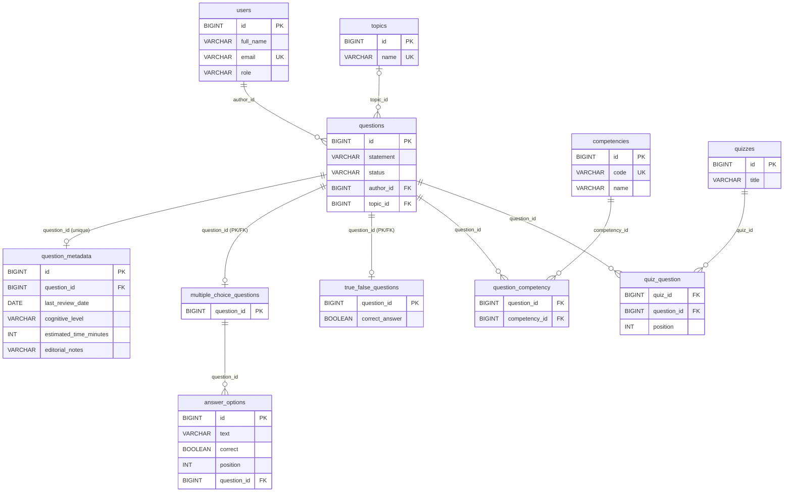

# Taller 10 — Persistencia de datos con JPA y arquitectura limpia

Banco de Preguntas Saber Pro · Laboratorio de Ingeniería de Software II · Universidad del Cauca · 2026.2

## Tecnologías

- Java 17+
- Spring Boot 3, Spring Data JPA
- H2 (base de datos en memoria)
- Maven, JUnit 5

## Estructura de paquetes

```
co.edu.unicauca.questionbank
├── api/                      # Controladores REST
├── application/              # Casos de uso (servicios)
├── domain/
│   ├── model/                # Clases de dominio puras (sin JPA)
│   └── repository/           # Contratos de repositorio
└── infrastructure/
    └── jpa/
        ├── record/           # Modelos relacionales JPA
        ├── repository/       # Implementaciones con Spring Data JPA
        └── mapper/           # Conversión dominio <-> record
```

## Análisis del dominio

**Actores:** Administrador (usuarios, roles y parámetros), Autor (crea y modifica preguntas), Revisor (evalúa calidad y pertinencia), Docente (organiza cuestionarios) y Estudiante (responde y consulta resultados).

**Ciclo de vida de una pregunta:**



Solo las preguntas **publicadas** pueden usarse en cuestionarios.

**Alcance elegido:** `User`, `Role`, `Topic`, `Competency`, `Question` (abstracta) con `MultipleChoiceQuestion` y `TrueFalseQuestion`, `AnswerOption`, `QuestionMetadata` y `Quiz`. Con estas clases se cubren los cuatro tipos de relación y la herencia que pide el taller. `Review`, `Attempt` y `Result` quedan fuera del alcance de este taller.

### Diagrama de clases del dominio



## Modelo relacional (JPA)

| Relación | Clases | Lado propietario / clave foránea |
|---|---|---|
| `@OneToOne` | `QuestionRecord` ↔ `QuestionMetadataRecord` | `question_metadata.question_id` (obligatoria y **única**: una pregunta no puede tener dos registros de metadatos) |
| `@OneToMany` / `@ManyToOne` | `MultipleChoiceQuestionRecord` → `AnswerOptionRecord` | `answer_options.question_id` (obligatoria; `cascade = ALL` y `orphanRemoval`: las opciones se eliminan con la pregunta) |
| `@ManyToOne` | `QuestionRecord` → `UserRecord` (autor) | `questions.author_id` (obligatoria) |
| `@ManyToOne` | `QuestionRecord` → `TopicRecord` | `questions.topic_id` (opcional hasta clasificar) |
| `@ManyToMany` | `QuestionRecord` ↔ `CompetencyRecord` | tabla intermedia `question_competency` |
| `@ManyToMany` | `QuizRecord` → `QuestionRecord` | tabla intermedia `quiz_question` (con `position`) |
| Herencia `JOINED` | `QuestionRecord` ← `MultipleChoiceQuestionRecord`, `TrueFalseQuestionRecord` | PK de cada subtabla = FK a `questions.id` |



## API REST

Los controladores de `api` solo reciben la solicitud, la convierten en una llamada a un caso de uso de `application` y devuelven DTOs (nunca objetos de dominio ni Records JPA).

| Método | Ruta | Caso de uso |
|---|---|---|
| `POST` | `/api/users` | Registrar usuario |
| `GET` | `/api/users/{id}` | Consultar usuario |
| `POST` | `/api/topics` | Crear tema |
| `POST` | `/api/competencies` | Crear competencia |
| `POST` | `/api/questions` | Crear pregunta (enunciado, autor, tipo, opciones, clasificación y metadatos opcionales) |
| `GET` | `/api/questions/{id}` | Consultar pregunta |
| `GET` | `/api/questions?authorId=&status=&topicId=&competencyId=` | Buscar preguntas por criterio |
| `PUT` | `/api/questions/{id}/classification` | Clasificar (tema y competencias) |
| `POST` | `/api/questions/{id}/submit` | Enviar a revisión (DRAFT → PENDING_REVIEW) |
| `POST` | `/api/questions/{id}/start-review` · `/approve` · `/reject` · `/publish` · `/archive` | Resto del ciclo de vida |
| `POST` | `/api/quizzes` | Crear cuestionario (solo preguntas publicadas) |
| `GET` | `/api/quizzes/{id}` | Consultar cuestionario |

Errores (`ProblemDetail`): `400` solicitud mal formada, `404` recurso inexistente, `409` violación de restricción (correo o código duplicado) y `422` regla de negocio incumplida.

```bash
curl -X POST localhost:8080/api/users -H "Content-Type: application/json" \
  -d '{"fullName":"Ana Autora","email":"ana@unicauca.edu.co","role":"AUTHOR"}'
curl -X POST localhost:8080/api/topics -H "Content-Type: application/json" -d '{"name":"Arquitectura de software"}'
curl -X POST localhost:8080/api/competencies -H "Content-Type: application/json" -d '{"code":"DESIGN","name":"Diseño de soluciones"}'
curl -X POST localhost:8080/api/questions -H "Content-Type: application/json" -d '{
  "statement":"¿Qué patrón desacopla la persistencia?","authorId":1,"type":"MULTIPLE_CHOICE",
  "topicId":1,"competencyIds":[1],
  "options":[{"text":"Repository","correct":true},{"text":"Singleton","correct":false},
             {"text":"Observer","correct":false},{"text":"Builder","correct":false},{"text":"Prototype","correct":false}]}'
curl -X POST localhost:8080/api/questions/1/submit
```

## Ejecución

```bash
mvn spring-boot:run
```

Consola H2: <http://localhost:8080/h2-console> (JDBC URL `jdbc:h2:mem:questionbank`, usuario `sa`, sin contraseña).

## Pruebas

```bash
mvn test
```
