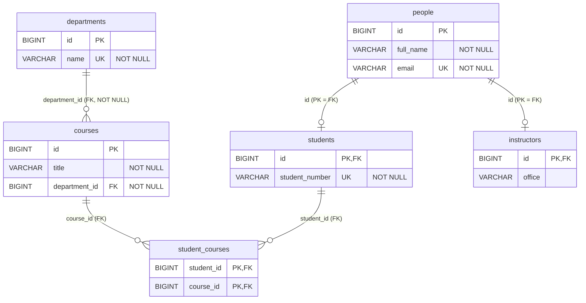

# Parte I — Actividad 1.2: relaciones en `infrastructure.jpa.record`

Fragmentos del demo `jpa-clean-persistence-demo`:

```java
// DepartmentRecord
@OneToMany(mappedBy = "department", cascade = CascadeType.ALL, orphanRemoval = true)
private List<CourseRecord> courses = new ArrayList<>();

// CourseRecord
@ManyToOne(fetch = FetchType.LAZY, optional = false)
@JoinColumn(name = "department_id", nullable = false)
private DepartmentRecord department;

// StudentRecord
@ManyToMany
@JoinTable(name = "student_courses",
    joinColumns = @JoinColumn(name = "student_id"),
    inverseJoinColumns = @JoinColumn(name = "course_id"))
private Set<CourseRecord> courses = new HashSet<>();
```

## 1. ¿Cuál es el lado propietario entre `DepartmentRecord` y `CourseRecord`?

**`CourseRecord`**, a través de su atributo `department`. En una relación uno a muchos bidireccional, el lado propietario es el que tiene la clave foránea en su tabla. Aquí es `courses.department_id`. JPA solo mira el lado propietario para escribir la FK: si se agrega un curso a `DepartmentRecord.courses` sin asignar `course.setDepartment(...)`, el `department_id` no se guarda. Por eso `DepartmentRecord.addCourse()` actualiza los dos lados.

`DepartmentRecord.courses` es el **lado inverso** (no propietario). Sirve para navegar y para propagar operaciones (`cascade`, `orphanRemoval`), pero no controla la columna.

## 2. ¿Por qué se usa `mappedBy = "department"`?

`mappedBy` le dice a JPA que la relación **ya está mapeada** por el atributo `department` de `CourseRecord` y que este lado es su reflejo. Sin `mappedBy`, Hibernate trataría `DepartmentRecord.courses` como una **segunda relación independiente** unidireccional, y para guardarla crearía una tabla intermedia `departments_courses` (o una FK duplicada con `@JoinColumn`). Habría dos fuentes de verdad para el mismo vínculo, y tablas y *updates* redundantes. El valor `"department"` es el **nombre del atributo Java** en `CourseRecord`, no el de la columna.

## 3. ¿Qué función cumple `@JoinColumn`?

Define la **columna de clave foránea** del lado propietario y sus restricciones:

- `@JoinColumn(name = "department_id", nullable = false)` en `CourseRecord`: crea la columna `courses.department_id NOT NULL`, con una FK a `departments(id)`. Sin el atributo `name`, Hibernate generaría el nombre `department_id` por convención; ponerlo explícito documenta el esquema. `nullable = false` (junto con `optional = false`) impide cursos sin departamento en la BD.
- Dentro de `@JoinTable`, `joinColumns = @JoinColumn(name = "student_id")` y `inverseJoinColumns = @JoinColumn(name = "course_id")` nombran las dos FK de la tabla intermedia: la que apunta al propietario (`students`) y la que apunta al otro lado (`courses`).

## 4. ¿Cómo se representa la tabla intermedia del muchos a muchos?

Con `@JoinTable(name = "student_courses", ...)` en `StudentRecord`, que es el lado propietario del `@ManyToMany`. Hibernate generó:

```sql
create table student_courses (
    course_id  bigint not null,
    student_id bigint not null,
    primary key (course_id, student_id)
);
alter table student_courses add foreign key (student_id) references students;
alter table student_courses add foreign key (course_id)  references courses;
```

- Cada fila es una matrícula (par estudiante–curso).
- Como la colección es un `Set`, la PK es **compuesta** `(course_id, student_id)` y no puede haber matrículas repetidas.
- La tabla no tiene entidad propia en Java: JPA la administra al agregar o quitar elementos de `StudentRecord.courses`. Si la matrícula necesitara datos propios (fecha, nota, estado), habría que convertirla en una entidad asociativa (`EnrollmentRecord`) con dos `@ManyToOne`.

## 5. Diferencia entre `DepartmentRecord.courses` y `StudentRecord.courses`

| | `DepartmentRecord.courses` | `StudentRecord.courses` |
|---|---|---|
| Relación | `@OneToMany` (1 departamento → N cursos) | `@ManyToMany` (N estudiantes ↔ N cursos) |
| Lado | **Inverso** (`mappedBy = "department"`) | **Propietario** (define `@JoinTable`) |
| Dónde se guarda | FK `courses.department_id` en la tabla del "muchos" | Tabla intermedia `student_courses` |
| Tipo de colección | `List` (permite orden; sin `@OrderColumn` no lo persiste) | `Set` (evita duplicados y genera una PK compuesta) |
| Cascada | `CascadeType.ALL` + `orphanRemoval = true`: el departamento es dueño del ciclo de vida de sus cursos. Si se borra el departamento se borran sus cursos, y un curso quitado de la lista se elimina | Sin cascada: los cursos existen independientemente del estudiante. Quitar un curso de la colección solo borra la fila de `student_courses`, no el curso |
| Sincronización | `addCourse()` actualiza los dos lados (`course.setDepartment(this)`) | `addCourse()` solo agrega al `Set`, porque `CourseRecord` no tiene la colección inversa (relación unidireccional) |

## 6. Esquema relacional



Versión en texto (para el informe):

```text
departments (id PK, name UNIQUE NOT NULL)
      1
      │
      N
courses (id PK, title NOT NULL, department_id FK → departments.id NOT NULL)
      1
      │
      N
student_courses (student_id FK → students.id, course_id FK → courses.id, PK(student_id, course_id))
      N
      │
      1
students (id PK/FK → people.id, student_number UNIQUE NOT NULL)
      │ 1:1 (JOINED)
people (id PK, full_name NOT NULL, email UNIQUE NOT NULL)
      │ 1:1 (JOINED)
instructors (id PK/FK → people.id, office)
```

Las restricciones se verificaron en la consola H2 con `INFORMATION_SCHEMA` (ver [1.4](1.4-evidencias-h2.md#35-tablas-relacionadas-claves-primarias-foráneas-y-únicas)).
