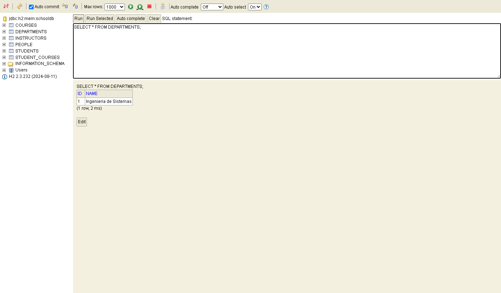
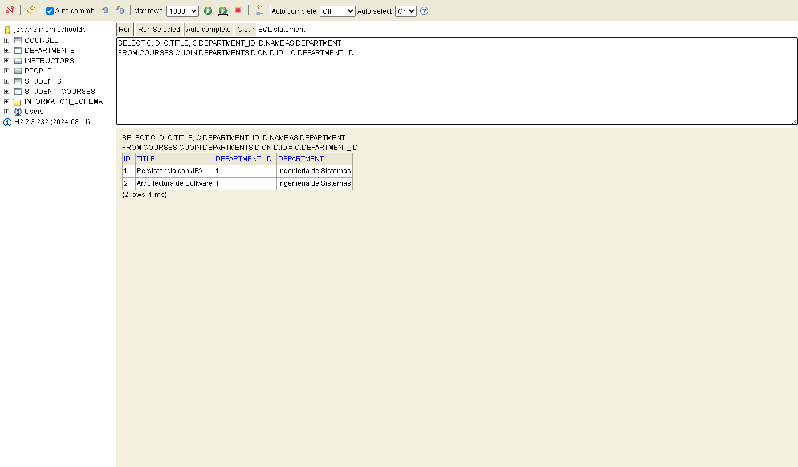
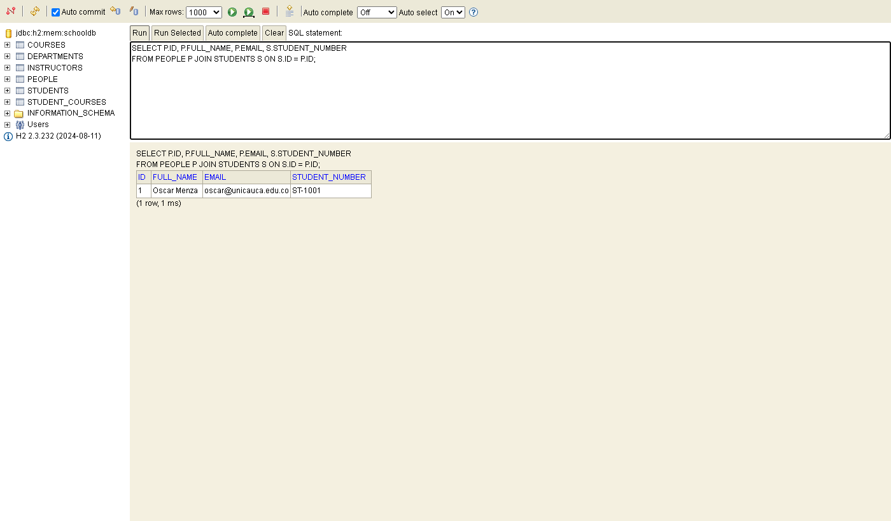
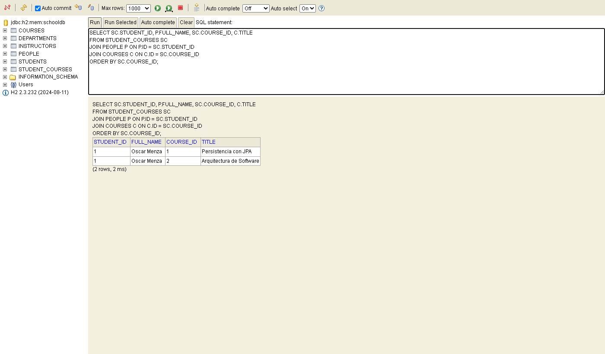
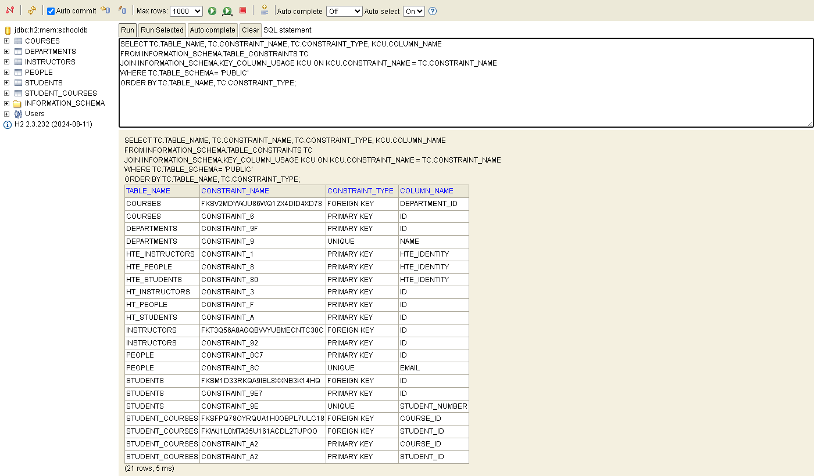
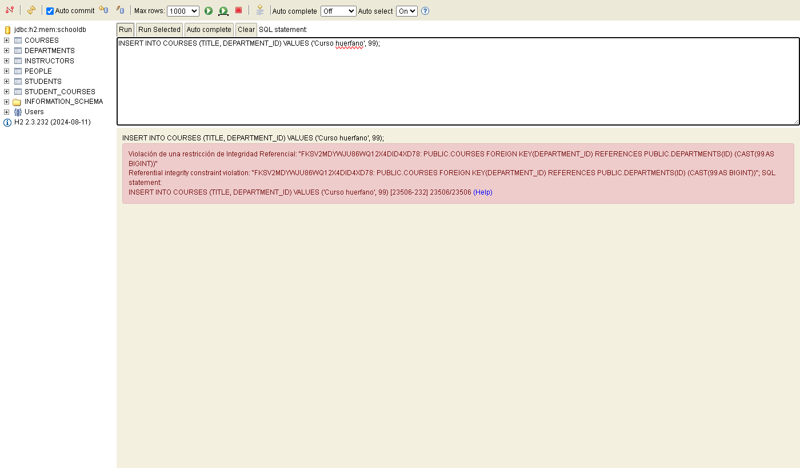

# Parte I — Actividad 1.4: ejecución del demo y evidencias en H2

Proyecto: `jpa-clean-persistence-demo` (Spring Boot 3.4.5, Hibernate 6, H2 2.3.232).

## 1. Ejecución

```bash
mvn spring-boot:run -Dspring-boot.run.arguments="--spring.jpa.show-sql=true"
```

La aplicación arranca en `http://localhost:8080`. Con `ddl-auto=create-drop`, Hibernate crea el esquema al iniciar. Este es el DDL que mostró la consola (sin las tablas temporales `HT_*`/`HTE_*`, que Hibernate usa internamente para operaciones masivas sobre la jerarquía):

```sql
create table departments (id bigint generated by default as identity, name varchar(255) not null unique, primary key (id))
create table courses (department_id bigint not null, id bigint generated by default as identity, title varchar(255) not null, primary key (id))
create table people (id bigint generated by default as identity, email varchar(255) not null unique, full_name varchar(255) not null, primary key (id))
create table students (id bigint not null, student_number varchar(255) not null unique, primary key (id))
create table instructors (id bigint not null, office varchar(255), primary key (id))
create table student_courses (course_id bigint not null, student_id bigint not null, primary key (course_id, student_id))
alter table if exists courses add constraint FK... foreign key (department_id) references departments
alter table if exists students add constraint FK... foreign key (id) references people
alter table if exists instructors add constraint FK... foreign key (id) references people
alter table if exists student_courses add constraint FK... foreign key (course_id) references courses
alter table if exists student_courses add constraint FK... foreign key (student_id) references students
```

## 2. Operaciones por la API

```bash
# Departamento
curl -X POST localhost:8080/api/departments -H "Content-Type: application/json" -d '{"name":"Ingenieria de Sistemas"}'
# -> {"id":1,"name":"Ingenieria de Sistemas"}

# Cursos asociados al departamento 1
curl -X POST localhost:8080/api/courses -H "Content-Type: application/json" -d '{"title":"Persistencia con JPA","departmentId":1}'
# -> {"id":1,"title":"Persistencia con JPA","departmentId":1}
curl -X POST localhost:8080/api/courses -H "Content-Type: application/json" -d '{"title":"Arquitectura de Software","departmentId":1}'
# -> {"id":2,"title":"Arquitectura de Software","departmentId":1}

# Estudiante
curl -X POST localhost:8080/api/students -H "Content-Type: application/json" \
  -d '{"fullName":"Oscar Menza","email":"oscar@unicauca.edu.co","studentNumber":"ST-1001"}'
# -> {"id":1,...,"studentNumber":"ST-1001","courseIds":[]}

# Matrícula (muchos a muchos)
curl -X POST localhost:8080/api/students/1/courses/1   # -> "courseIds":[1]
curl -X POST localhost:8080/api/students/1/courses/2   # -> "courseIds":[2,1]

# Consultas
curl localhost:8080/api/departments
curl localhost:8080/api/courses
curl localhost:8080/api/students
```

> Observación: `courseIds` sale como `[2,1]` porque `StudentRecord.courses` es un `HashSet`, que no garantiza orden. Si el orden importara, habría que usar `List` con `@OrderColumn` o `@OrderBy`.

## 3. Evidencias en la consola H2

Conexión: `http://localhost:8080/h2-console`, JDBC URL `jdbc:h2:mem:schooldb`, usuario `sa`, sin contraseña.


### 3.1 Creación de un departamento

```sql
SELECT * FROM DEPARTMENTS;
```



### 3.2 Curso asociado al departamento (`@ManyToOne` → FK `department_id`)

```sql
SELECT C.ID, C.TITLE, C.DEPARTMENT_ID, D.NAME AS DEPARTMENT
FROM COURSES C JOIN DEPARTMENTS D ON D.ID = C.DEPARTMENT_ID;
```



### 3.3 Registro del estudiante (herencia `JOINED`: fila en `PEOPLE` + fila en `STUDENTS` con el mismo id)

```sql
SELECT P.ID, P.FULL_NAME, P.EMAIL, S.STUDENT_NUMBER
FROM PEOPLE P JOIN STUDENTS S ON S.ID = P.ID;
```



### 3.4 Matrícula en cursos (`@ManyToMany` → tabla intermedia `STUDENT_COURSES`)

```sql
SELECT SC.STUDENT_ID, P.FULL_NAME, SC.COURSE_ID, C.TITLE
FROM STUDENT_COURSES SC
JOIN PEOPLE P ON P.ID = SC.STUDENT_ID
JOIN COURSES C ON C.ID = SC.COURSE_ID
ORDER BY SC.COURSE_ID;
```



### 3.5 Tablas relacionadas: claves primarias, foráneas y únicas

```sql
SELECT TC.TABLE_NAME, TC.CONSTRAINT_NAME, TC.CONSTRAINT_TYPE, KCU.COLUMN_NAME
FROM INFORMATION_SCHEMA.TABLE_CONSTRAINTS TC
JOIN INFORMATION_SCHEMA.KEY_COLUMN_USAGE KCU ON KCU.CONSTRAINT_NAME = TC.CONSTRAINT_NAME
WHERE TC.TABLE_SCHEMA = 'PUBLIC'
ORDER BY TC.TABLE_NAME, TC.CONSTRAINT_TYPE;
```



Se confirma:

- `COURSES.DEPARTMENT_ID` → `DEPARTMENTS.ID`.
- `STUDENTS.ID` → `PEOPLE.ID` e `INSTRUCTORS.ID` → `PEOPLE.ID` (herencia `JOINED`: la PK de la subtabla también es FK).
- `STUDENT_COURSES` tiene una PK compuesta `(COURSE_ID, STUDENT_ID)` y dos FK. Un estudiante no puede matricularse dos veces en el mismo curso.
- Hay `UNIQUE` en `DEPARTMENTS.NAME`, `PEOPLE.EMAIL` y `STUDENTS.STUDENT_NUMBER`.

### 3.6 La FK impide relaciones inválidas

```sql
INSERT INTO COURSES (TITLE, DEPARTMENT_ID) VALUES ('Curso huerfano', 99);
```



H2 rechaza el curso porque el departamento 99 no existe (*Referential integrity constraint violation*).

> Por la API, el mismo caso (`POST /api/courses` con `departmentId: 99`) responde **500**. `CourseRepositoryJpa` lanza `IllegalArgumentException` y el demo no tiene un `@ControllerAdvice` que la convierta en 404/422. En nuestro proyecto lo resolvimos con `ApiExceptionHandler`.

## 4. Entregable de la Parte I

| Entregable | Documento |
|---|---|
| Tabla de arquitectura y respuestas | [1.1 Reconocimiento de la arquitectura](1.1-arquitectura.md) |
| Relaciones y diagrama del esquema relacional | [1.2 Relaciones](1.2-relaciones.md) |
| Herencia JOINED | [1.3 Herencia](1.3-herencia.md) |
| Evidencias en H2 | Este documento |
